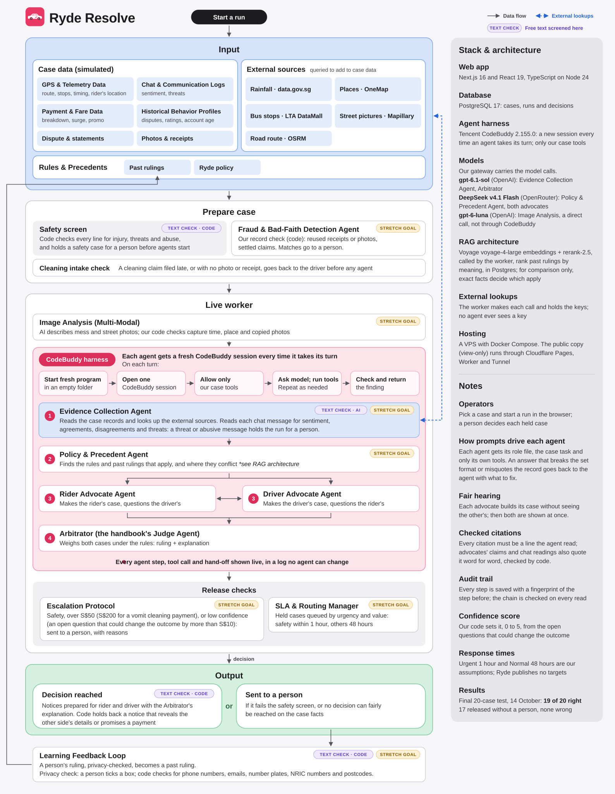

# Ryde Resolve

## What it is

Ryde Resolve is an agentic dispute resolution system that handles disputes between riders and drivers on a ride-hailing app: no-show fees, route detours, fares and surge pricing, promo codes, cleaning fees, cancellation fees, and so on.

Five AI agents work on a case, in this order:

1. The **Evidence Collector** lays out the facts: a timeline tied to each source, outside information such as the street route, and what evidence is missing. It does not take sides.
2. The **Policy Analyst** works out which of Ryde's rules apply, which of their conditions are met, and which past rulings compare.
3. The **Rider Advocate** and the **Driver Advocate** each argue for one side, challenge the other side, then answer the challenges.
4. The **Arbitrator** weighs both sides and recommends a decision, with one explanation that both sides read.

If a case has photos, an AI model describes them before the Evidence Collector starts. If someone reports a safety problem, or the chat shows a possible threat, the case goes to a person before the other agents argue it.

The system combines fixed rules, written in code, with the agents' judgement. Before any agent starts, code compares the case's receipts and photos with earlier claims. A reused receipt, a near-copy of an earlier photo, or a claim that was already paid is a red flag: a person checks the decision before it is released. A red flag is a reason to look, not proof of fraud.

After the Arbitrator, fixed rules also decide whether its decision is released or goes to a person first: for example when someone's safety is involved, a large amount is at stake, or an open question could change the result.

The system recommends and explains. It does not take payments, pay refunds or change accounts.

## How it is built

Where each part's code lives:

- **Web app** (`apps/web`): the website. It shows a case's evidence, what each agent wrote, the decision and its reasons, and lets a person review it. It also has a library of past rulings.
- **Live worker** (`apps/agent-runner`): takes a waiting run from the database and works the case step by step. Each agent runs as its own CodeBuddy session, in its own process, and can use only the tools its role allows.
- **Model gateway** (`apps/model-gateway`): a small server that holds the model keys, so the agents never see them. It accepts only the models on its list and passes calls to OpenAI or OpenRouter. Without it, the agents use CodeBuddy's own hosted models, and photos are not described.
- **PostgreSQL**: the database. It keeps the cases, the runs, every agent's output and a log of every event.
- **Caddy**: the front door. It asks for a login on the operator's site and keeps that site apart from the read-only public view.

## Data disclaimer

- The three cases in `evidence/disputes` were made up for this project. No answer keys ship with them.
- The photos are synthetic: made by AI for this project.
